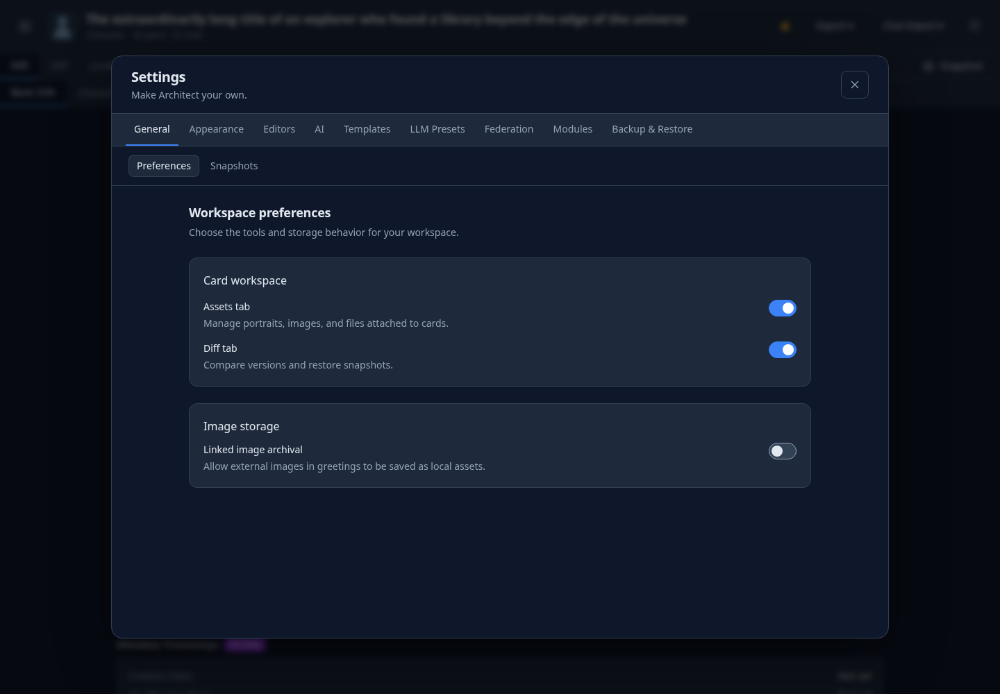
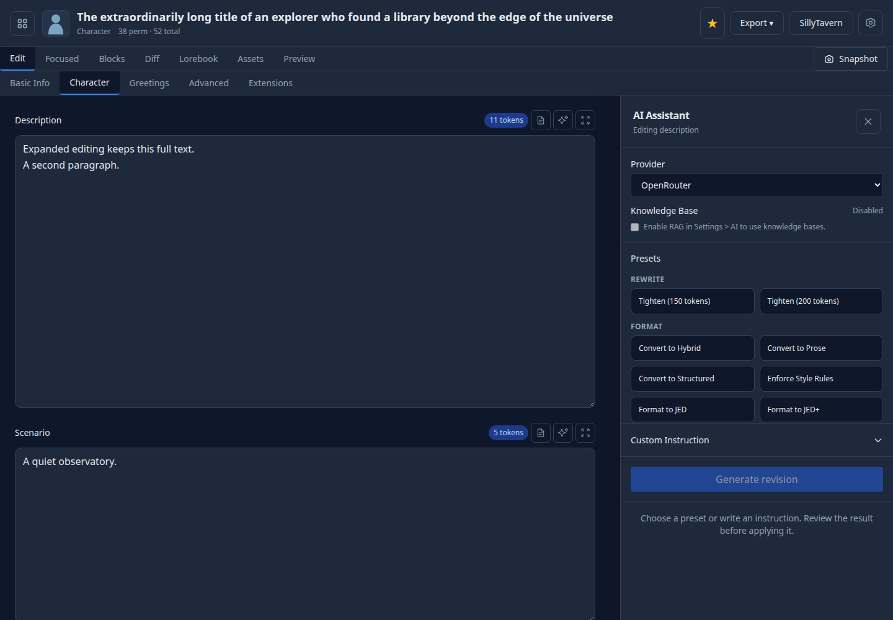

# Modules (apps/web)

Modules are optional feature bundles that can register editor tabs and/or settings panels at runtime.

## Files and conventions

Each module lives in `apps/web/src/modules/<module-id>/` where `<module-id>` is **kebab-case** (example: `charx-optimizer`).

Required files:

- `apps/web/src/modules/<module-id>/metadata.ts`
  - Exports `MODULE_METADATA` (no side effects).
- `apps/web/src/modules/<module-id>/index.ts`
  - Exports `register<PascalCaseId>Module()` (and optionally `unregister…`).

Naming:

- Module ID: `charx-optimizer`
- Feature flag key (in `settings-store`): `charxOptimizerEnabled`
- Register function: `registerCharxOptimizerModule`

The feature-flag name is derived from the module id:

```ts
// charx-optimizer -> charxOptimizerEnabled
const flagName = `${moduleId.replace(/-([a-z])/g, (_, l) => l.toUpperCase())}Enabled`;
```

## Metadata (must be side-effect free)

`metadata.ts` is imported eagerly at app startup so the Settings UI can show toggles. It **must not** import code that performs runtime work (stores, network clients, registrations, etc.).

Example `metadata.ts`:

```ts
import type { ModuleDefinition } from '../../lib/registry/types';

export const MODULE_METADATA: ModuleDefinition = {
  id: 'my-module',
  name: 'My Module',
  description: 'What it does.',
  defaultEnabled: false,
  badge: 'Beta',
  color: 'blue',
  order: 50,
  requiresServer: false,
};
```

## Registration and settings categories

`index.ts` should only register things inside the exported `register…` function. Avoid any “do work on import” patterns.

Example `index.ts`:

```ts
import { lazy } from 'react';
import { registry } from '../../lib/registry';
import { useSettingsStore } from '../../store/settings-store';
export { MODULE_METADATA } from './metadata';

const MyPanel = lazy(() =>
  import('./components/MyPanel').then((m) => ({ default: m.MyPanel }))
);

export function registerMyModuleModule() {
  registry.registerTab({
    id: 'my-module',
    label: 'My Module',
    component: MyPanel,
    color: 'blue',
    order: 50,
    contexts: ['card'],
    condition: () => useSettingsStore.getState().features?.myModuleEnabled ?? false,
  });
}
```

## Server-only modules and deployment modes

If your module needs the API backend, set `requiresServer: true` in `MODULE_METADATA`.

- In `light` and `static` modes, server-only modules are never loaded.
- The module toggle stays visible but disabled (marked “Full mode only”).

If you want per-mode defaults, add an entry to:

- `apps/web/src/config/deployment.ts` → `DeploymentConfig.moduleDefaults`
- Update `FULL_CONFIG`, `LIGHT_CONFIG`, `STATIC_CONFIG`

## Contextual settings navigation

Settings panels declare a `group` and, when applicable, a `moduleId`. Do not infer ownership from the panel ID: `blockeditor-settings`, for example, belongs to `block-editor`.

```ts
registry.registerSettingsPanel({
  id: 'my-editor-settings',
  label: 'My Editor',
  group: 'editors',
  moduleId: 'my-editor',
  component: MyEditorSettings,
  order: 50,
});
```

- `editors`: Standard, Focused, Blocks, and Wizard. Optional editors declare `category: 'editor'` in metadata. Their registration functions run even while disabled so settings remain discoverable; only their card tabs have an enabled condition. Keep components lazy and registration free of network calls or other feature work.
- `ai`: Providers and Knowledge & RAG.
- `federation`: Connection overview, direct chat destinations, and Federation sync. Connection modules declare `category: 'connection'`. Direct Lumiverse/SillyTavern sending does not require the Federation module to be enabled.
- `modules`: An overview of other module toggles and settings contributed by enabled modules. Legacy `row: 'modules'` panels also appear here.
- `general`: Workspace preferences and snapshots. Appearance, Templates, LLM Presets, and Backup & Restore retain their own categories.

The navigation only shows the selected category's subtabs. A module's settings condition still controls visibility outside Editors. Feature changes invalidate registry caches immediately; toggles do not require a page reload.

Lumiverse is disabled by default. Its optional `migrateEnabled()` metadata callback preserves an existing enabled server connection when the browser has no module preference yet. The callback lazily imports the API client, runs only in supported deployments after startup, and never overrides an explicit toggle. Metadata imports themselves remain side-effect free.



## Editor workspace

The card header contains Favorite, Export, enabled chat destinations, and Settings. A single chat destination sends directly; two destinations use the Chat Export menu. New Card and Import stay on the library page.

Standard editor text fields have an expand action. The modal edits the same controlled field value, using the existing draft and autosave flow; Done and Escape return to the inline editor without discarding text. Focused mode already supplies a large editing surface.



## Testing checklist

- `pnpm type-check`
- `CF_FIXTURES_DIR="$PWD/test-fixtures" pnpm test`
- `pnpm build`
- Confirm disabled editor settings remain available while their card tabs stay hidden.
- Confirm newly toggled modules update tabs immediately and retain their state after reload.
- Confirm server-only modules and their migration callbacks do not run in light/static mode.
